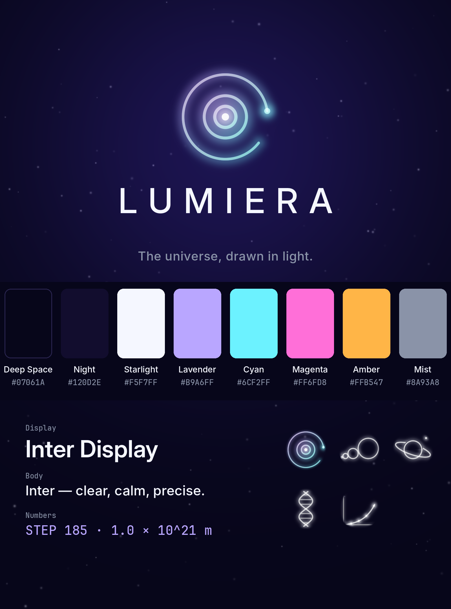
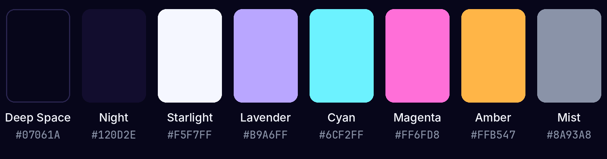

# Lumiera: brand guide

**Tagline:** The universe, drawn in light.  
**Signature line:** Guess before it ends.  
**Name:** from *lumière*, French for light.

## Logo

The mark is the first frame of *The Doubling*: a point of light with rings whose radii double (×2, ×2). The outer ring is left open, and a small cyan dot sits at its end: *you are here*.

- **Files:** `assets/logo/` contains the mark (transparent, on dark, white mono), the LUMIERA wordmark (white and dark), and horizontal and stacked lockups.
- **Clear space:** keep empty space around the mark at least the radius of its middle ring.
- **Minimum size:** 32 px for the full-colour mark. Below that, use the white mono version.
- **Backgrounds:** deep space or any dark, calm background. On light backgrounds use the wordmark in Deep Space, without the glowing mark.
- **Don't** recolour individual rings, stretch the mark, add drop shadows or outlines, or close the open ring.

## Colour

| Name | Hex | Use |
|---|---|---|
| Deep Space | `#07061A` | Backgrounds |
| Night | `#120D2E` | Raised backgrounds, gradients |
| Starlight | `#F5F7FF` | Main text, the core of the mark |
| Lavender | `#B9A6FF` | Primary accent |
| Cyan | `#6CF2FF` | "You" and key highlights |
| Magenta | `#FF6FD8` | Big reveals, the universe |
| Amber | `#FFB547` | Warm accent (Sun, life) |
| Mist | `#8A93A8` | Secondary text, labels |

Use one accent colour per scene and keep everything else in Starlight and Mist.

## Type

| Role | Font | Notes |
|---|---|---|
| Wordmark | Inter Display Medium, caps, +32% letter spacing | Only for the word LUMIERA |
| Headlines, titles | Inter Display Bold / SemiBold | Caps for on-screen titles ("THE MILKY WAY") |
| Body, captions | Inter Medium / Regular | Sentence case |
| Numbers, counters, units | JetBrains Mono | "STEP 116", "1.7 × 10⁰ m" |

All three fonts are free and open-source (Google Fonts / JetBrains).

## Video style

- Vertical 9:16, 1080×1920 at 60 fps. Deep-space background, with subjects drawn as glowing light.
- One clear question per video. Give viewers time to guess, then act out the answer: copies line up, counters climb, and a step chip marks each stop.
- Keep text out of the bottom ~18% (caption area) and the right-hand button column.
- Loop the ending back into the first frame when you can.
- Every number is checked, and the sizes used are listed in the description.

## Voice

- Open with an honest question the viewer can answer in their head, and close that loop in the same video. Never hold the answer back for a 'part 2' or a follow.
- Give the guess room to happen: ask, then let the counter run. 'Guess before it ends.' is the house signature for hooks, bios, captions and pinned comments.
- Numbers are sacred. Check every figure against a source and keep it identical across the video, caption, title and comments. Use 'about' or '~' when rounding, never round in the direction that sounds more impressive, and list the sizes used in the description.
- Keep the precise qualifiers: 'observable universe', 'where known physics runs out', 'on average', 'in theory'. Flag any simplification in one plain line.
- Calm, precise, awe-filled. Write short declarative sentences, mostly in the present tense, and let the scale do the shouting. Never use 'mind-blowing', 'insane', 'you won't believe' or 'wait for it', fake urgency, or exclamation marks.
- Comment prompts must have a real answer. Ask for a guess, a prediction or the next thing to measure. Never use 'only 1% get this' or tease something the video doesn't deliver.
- Put the viewer on the scale, sparingly. 'You' is the measuring stick ('Doubling 116. Remember that.'), not someone to shout at. Address the viewer at most once or twice per caption.
- Gallery typography. Use sentence case everywhere except profile names, step chips and end cards, and use '·' and line breaks as punctuation. Use at most one ✦ per text (the house mark) and ↓ only as a pointer to a link. No marks in titles or on-screen text.
- Correct in public. If a number is wrong, pin a short correction with the right figure and a source and thank whoever caught it. Never argue and never delete.

## Content pillars

### Scale · How big is that?

The signature series that The Doubling starts. Sizes, distances, durations and quantities too large or too small to feel are made visible one step at a time, with step chips, a climbing counter and copies of the previous thing lining up. Each film opens with a number the viewer guesses before the reveal. This is the most shareable pillar, so post it most often early on.

- The Halving, the direct sequel. Start at you (doubling 116) and halve your way down. How many halvings until you're the size of a hydrogen atom? The answer is 34 (116 - 82), and it is still about 34 on unrounded values. Reuse the logo rings and close on 'Remember that.'
- The Doubling: Time. Start at the Planck time (5.4 × 10⁻⁴⁴ s) and double up to the age of the universe, which takes about 202 doublings. Hook: space took 205. Will time take more or fewer? Stops include a camera flash, a heartbeat, a human life and the age of the Sun. Compute and source every stop before scripting.
- Fold it 42 times. In theory, a 0.1 mm sheet of paper folded in half 42 times would be about 440,000 km thick, past the Moon's average distance of about 384,400 km. The glowing stack climbs one fold at a time, and one plain line says that real paper can't be folded that many times.
- A million, a billion, a trillion seconds. Three glowing clocks run to about 11.6 days, about 31.7 years and about 31,700 years. Viewers guess where each one lands. The third clock is still running when the film ends.

### Cosmos & Light · How far, how fast?

Space and the physics of light. This pillar carries the name (lumière) most directly: how light travels, scatters and interferes, and where things really sit in the sky. Each film is built on one precise image, and honest qualifiers such as 'observable' and 'on average' stay in.

- Sunlight, in transit. One photon leaves the Sun's surface while a timer runs, and it reaches Earth about 8 minutes 20 seconds later on average. Viewers guess the time before it lands. The sunlight on your face is already that old.
- If space is full of stars, why is the night sky dark? Olbers' paradox: the sky fills with stars that should make it blaze, then the universe's finite age and light's finite speed leave it dark.
- One photon at a time. Light passes through two slits one photon at a time. Each photon lands as a single random dot while a counter climbs, and the dots slowly build an interference pattern.
- Do all the planets fit between Earth and the Moon? The honest answer depends on how you measure: center to center or surface to surface, mean or equatorial diameters. Show each version as it plays out. The point is precision, not a viral 'yes'.

### Life, Measured · How many of you?

Biology at its true scale. Cells, DNA, blood and growth are counted and laid out the way The Doubling laid out the virus, the red blood cell and the ant, so the body becomes a landscape of real numbers. Estimate ranges are shown honestly.

- Counting you. An adult body holds roughly 30 trillion human cells, and most of them are red blood cells. Viewers guess the total before the counter finishes filling a silhouette by cell type. It links back to the red blood cell at step 99.
- Your DNA, unspooled. The DNA in one of your cells, stretched end to end, is about 2 meters long, packed into a nucleus a few micrometers across. The glowing strand unwinds next to a person-height marker.
- One bacterium, doubling. Under ideal lab conditions E. coli can divide about every 20 minutes. The colony doubles on a counter, then the film shows why real growth stops: food runs out, waste builds up and space fills.

### Pure Patterns · Why does that work?

Math made visible. Probability, geometry and number patterns are drawn as light, so an abstract result becomes something you watch happen and can check for yourself. Each film has one surprising answer.

- The birthday threads. People appear one by one, and a thread of light joins every possible pair. Viewers guess the room size first. At 23 people there are 253 pairs, and the chance of a shared birthday passes 50% (about 50.7%).
- The chessboard and the rice. One grain goes on the first square, and the count doubles on every square after. The counter races to 18,446,744,073,709,551,615 grains (2⁶⁴ − 1) on the full board: The Doubling's idea in 64 steps.
- Pi from falling light. Random points of light fall into a square with a circle inside it. The share landing inside the circle, times 4, settles toward 3.14159… as a counter climbs.
- Draw anything with spinning circles. A Fourier series is built one glowing circle at a time until the chain traces the Lumiera logo: a glowing dot with rings that double in radius.

## Starter hashtag sets (max 5 per post)

| Pillar | Hashtags |
|---|---|
| Scale | #science #scaleoftheuniverse #sizecomparison #physics #space |
| Cosmos & Light | #space #astronomy #physics #light #scienceexplained |
| Life | #biology #humanbody #science #cells #scienceexplained |
| Patterns | #math #mathematics #probability #science #scienceexplained |
